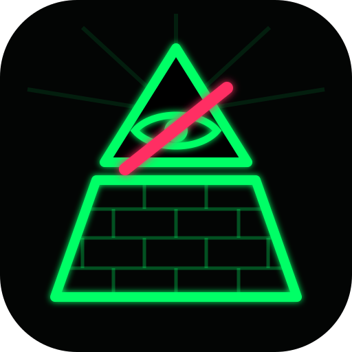

# Surveillance Slop Remover

Removes surveillance junk from links and photos on Android — automatically, offline, with **no internet permission**.

- **Automatic cleaning** — copy a link in an app and it's cleaned on your clipboard; paste a tracked link into any text box and the clean version is swapped in (covers links copied inside web pages, e.g. X's website in Vanadium).
- **Link opener** — set as default browser app; every link you tap is cleaned and handed to your real browser.
- **Photo metadata remover** — Share → "Remove photo metadata": strips GPS, phone model, timestamps, edit history and embedded Motion Photo video. Lossless for JPEG/PNG/WebP.
- Also: Quick Settings tile, Share → "Clean links", Select text → "Clean links".

Built for [GrapheneOS](https://grapheneos.org), works on any Android 10+.

## What gets removed

X/Twitter share trackers · YouTube `si`/`pp`/`feature` · AI-assistant tags on cited sources (`utm_source=chatgpt.com`, Perplexity, Gemini, Copilot) and `#:~:text=` fragments · `utm_*` · ad click IDs (`fbclid`, `gclid`, `msclkid`, `ttclid`, `twclid`, …) · e-mail marketing IDs (Mailchimp, HubSpot, Marketo, Substack) · per-site rules for Instagram, Threads, Facebook, TikTok, Reddit, LinkedIn, Spotify, Apple, Amazon, eBay, Google & Bing · redirect wrappers unwrapped. Functional parameters (search terms, timestamps, video IDs, page numbers) are kept. See [`LinkCleaner.java`](app/io/github/bitcoinismoral/linkcleaner/LinkCleaner.java) and its tests in [`buildtools/LinkCleanerTest.java`](buildtools/LinkCleanerTest.java).

## Privacy

- No `INTERNET` permission, no dependencies, no analytics. ~120 KB.
- The accessibility service (optional, for automatic cleaning) looks only at the label of a tapped "Copy" button, "Copied" notices, and text just pasted into a text box. It declares `canRetrieveWindowContent` solely to replace pasted text with the cleaned link, on the source of that one "text changed" event. See [`CopyWatcherService.java`](app/io/github/bitcoinismoral/linkcleaner/CopyWatcherService.java).
- Cleaned photo copies are served read-only to the app you share with, via a non-exported provider, and deleted after an hour.

## Building

Two independent ways, producing equivalent APKs:

1. **Standard Gradle** (what F-Droid uses): `gradle :android:assembleRelease`
2. **Open-source-only, no Android SDK**: [`build.sh`](build.sh) uses OpenJDK, R8/D8 and apksig only. Android APIs are compile-time [stubs](stubs/) checked against AOSP's public API list by [`verify_stubs.py`](buildtools/verify_stubs.py); [`ResEncoder.java`](buildtools/ResEncoder.java) writes the binary manifest and resource table in place of `aapt2`, and also generates the text manifest the Gradle build uses.

CI runs both builds, the tests, and the stub verification on every push.

## License

[GPL-3.0-only](LICENSE)
